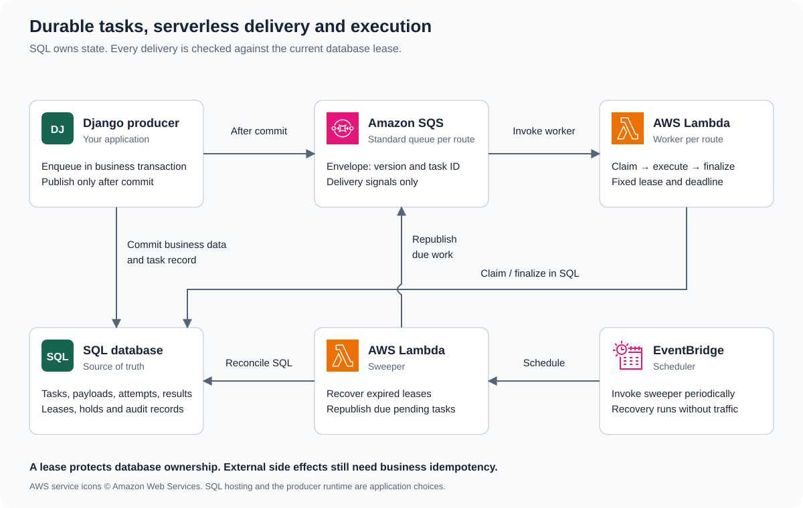

============
Architecture
============

django-tasks-aws separates *durable intent* from *delivery* from *execution*.
The database is the single source of truth; the queue is only a hint that work
exists; the worker is only ever allowed to act on what the database still
authorizes.

Ownership model
===============

.. list-table::
   :header-rows: 1

   * - Component
     - Responsibility
   * - SQL database
     - Durable owner of task state, attempts, leases, holds, and audit events
   * - SQS (standard)
     - Delivery signal: an envelope holding ``{schema_version, task_id}``
   * - Lambda worker
     - Claims a lease, executes the importable task, finalizes the attempt
   * - EventBridge Scheduler
     - Triggers the sweeper on a schedule
   * - Sweeper
     - Reconciles expired leases, lost publications, and unfinished work

The producer writes a ``TaskRecord`` inside its own business transaction and
registers an ``on_commit`` callback to publish the delivery envelope. Workers
and the sweeper operate on the same records. A queue message is a *hint*, not
permission: the worker always re-validates against the database before acting.

Lifecycle at a glance
=====================

#. **Enqueue** — the producer inserts a ``PENDING`` task row in its transaction
   and schedules an SQS publish for after commit.
#. **Dispatch** — the envelope is published (best effort) or, if lost, rediscovered
   by the sweeper.
#. **Claim** — a worker receives the envelope, looks up the task, and acquires a
   fixed, non-renewable lease before executing.
#. **Execute** — the worker runs the importable task under a hard deadline
   budget.
#. **Finalize** — the worker records ``SUCCESSFUL`` or ``FAILED``, or an
   ``ABANDONED`` attempt when its deadline expired mid-work.
#. **Reconcile** — the sweeper reaps expired leases, retries exhausted delivery,
   and bounds work that never reached a claim.

Invariants
==========

Coordination uses Django ORM transactions, row locks, conditional updates, and
query expressions. Claims lock the task before allocating a lease and creating
its attempt in the same transaction; recovery skips rows locked by other workers.
Finalization locks the task before checking lease expiry, then locks its attempt.
SQS publication happens outside these transactions. Swappable database adapters
provide writer validation, wall-clock expressions, and scoped coordination
transactions. PostgreSQL uses ``CLOCK_TIMESTAMP()``, MySQL/MariaDB use ``SYSDATE(6)``,
and Oracle uses ``SYS_EXTRACT_UTC(SYSTIMESTAMP)`` so lock waits count toward
lease expiry. Row-lock helpers handle engine-specific query limits and lock options. See :doc:`database-backends` for the
adapter contract and engine-specific timeout behavior.

The schema encodes the correctness contract as database constraints (see
:class:`~django_tasks_aws.models.TaskRecord`):

* At most one current claim exists per task; a ``RUNNING`` task has exactly one
  lease token and expiry, and a non-``RUNNING`` task has none.
* Lease/hold/dispatch field pairs are both-or-neither.
* Terminal statuses carry a ``finished_at``; non-terminal statuses do not.
* ``attempts_started`` never exceeds ``max_attempts``.
* A business deduplication key is unique within its scope when non-NULL.

Retry and ambiguity
===================

There are two distinct retry layers:

* **Delivery** — SQS redrive and sweeper rediscovery retry the *signal*, never
  the business effect, without consuming the execution budget.
* **Execution** — a failed attempt consumes the ``max_attempts`` budget; backoff
  is database-scheduled with jitter and a cap.

When a worker dies after its remote effect may have succeeded, the outcome is
*ambiguous*. The task policy decides whether to retry or hold the task with
``ambiguous_external_outcome``, awaiting an audited operator review. See
:doc:`configuration` for the policy knobs.

Idempotency is a business concern. The package derives and persists an
*operation key* so replay lineage survives, but it does not manufacture provider
idempotency. See :ref:`operations-operation-key`.

Deployment shape
================

Workers are split into named routes (for example ``short`` and ``documents``),
each backed by its own SQS queue and Lambda function. The route manifest is
produced by Terraform and injected into every producer and worker. Each worker
validates its own identity against the manifest before claiming work.

   SQL owns durable state; SQS delivers task identities. EventBridge Scheduler
   invokes the recovery sweeper independently of producer traffic.

The diagram uses official `AWS Architecture Icons
<https://aws.amazon.com/architecture/icons/>`_. The self-contained SVG is the
editable source; icon provenance is recorded alongside it in
``_static/task-system-design.md``.

The repository's ``docs/implementation-spec.md`` records the frozen first-release
contract, scope, and requirement-ID scheme. The optional workflow layer described
in :doc:`workflows` coordinates dependencies through this same execution model.

Failure windows and their recovery
==================================

The transaction and queue cannot commit as one unit. The protocol therefore
keeps enough database state to recover each gap:

.. list-table::
   :header-rows: 1
   :widths: 35 65

   * - Interruption
     - Durable interpretation
   * - Producer rolls back before commit
     - Neither the task nor its commit callback survives.
   * - Producer commits but publication fails
     - The task remains pending; the sweeper can publish it later.
   * - The queue delivers the same envelope twice
     - Both deliveries refer to one task; claims are serialized by its row lock.
   * - Worker disappears after claiming
     - The fixed lease eventually expires; recovery closes the abandoned attempt.
   * - Worker returns after its lease expires
     - Its old ownership token cannot finalize the task's current state.
   * - Provider succeeds but worker cannot save the result
     - The outcome may be ambiguous; policy and operator review determine recovery.

A lease fences database ownership, not a remote service. An expired worker
might already have sent a request, so preventing its late SQL finalization
cannot undo that request. This is why external operation identities remain
necessary even with correct row locking.

State, holds, and attempts
==========================

The core task status is ``PENDING``, ``RUNNING``, ``SUCCESSFUL``, or ``FAILED``.
A retry returns work to pending with a future eligibility time. A hold is a
separate reason on the task rather than a fifth terminal status. Pending work
can consequently be scheduled, retrying, held, or due; inspect these categories
before interpreting every pending row as a queue problem.

An attempt starts when a worker successfully claims, not when SQS receives or
delivers an envelope. Several deliveries can occur without consuming an attempt.
The attempt history records execution outcomes; the task row summarizes the
current ownership and result. Control audit records explain operator decisions
without rewriting that history.

Capacity and timing
===================

Each route isolates a workload's queue and function configuration. Concurrency
limits simultaneous invocations, while task duration determines throughput.
The database must support connections and short coordination transactions from
all active worker environments, producers, and the sweeper. Increasing Lambda
concurrency can move the bottleneck to SQL or a downstream provider.

Queue visibility hides a delivery temporarily; it is not the execution lease.
The database lease decides who owns a task, and the Lambda deadline bounds how
long the worker can run. Configure all three from the same route manifest as
explained in :doc:`configuration`. Sweeper cadence adds recovery latency after
lease expiry or publication loss; it is part of the availability design.
