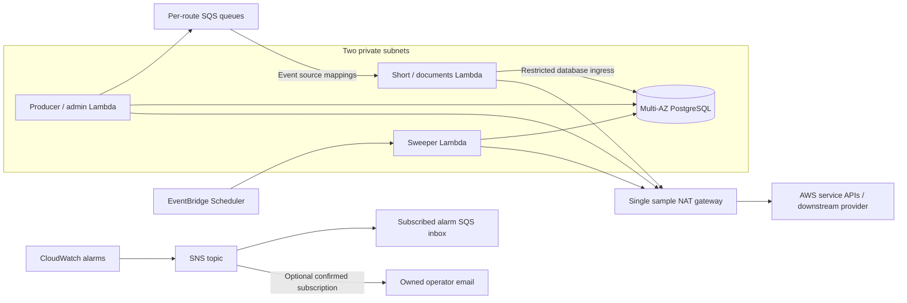

# Operating django-tasks-aws

Install the package, include `django_tasks_aws` in `INSTALLED_APPS`, and run
`python manage.py migrate`. Each package app has one `0001_initial` migration
containing its complete current schema. A Django app without the
web admin can continue to use the backend and commands.

## Inspect before acting

Run these from a configured consumer, using its normal database credentials:

```sh
uv run python manage.py tasks_list --problematic --queue documents --limit 50 --json
uv run python manage.py tasks_show TASK_UUID --attempts --json
uv run python manage.py tasks_workers --json
uv run python manage.py tasks_check --fail-on-problems --json
```

Use `--backend NAME` to select a configured backend. Inspection commands never
publish or repair work. `tasks_show --sensitive` includes arguments, results,
and retained error text: the command runner's deployment/database access is
its authorization boundary. Do not grant a shell to someone who should only
have the restricted admin view.

`tasks_list` supports `--queue`, `--category`, `--status`, `--task-name`,
`--hold-reason`, `--search`, `--limit` (1–200), and `--offset` (0–100000).
Search accepts task IDs, attempt IDs, import paths, and operation/submission
keys. Pages are ordered by creation time and task ID; `next_offset` is null at
the end. Concurrent changes can alter a later page's membership.

The categories are `scheduled`, `retrying`, `due`, `overdue`, `reserved`,
`running`, `expired`, `held`, `exhausted`, `successful`, and `failed`.
`due` means runnable; `overdue` additionally requires execution eligibility
older than `overdue_grace_seconds` and due redispatch. Future retries and live
publication reservations are not overdue. Worker summaries count unfinished
work only, so terminal history does not inflate summary work.

## Release, replay, dispatch, and recovery

Every control request needs an actor, a reason, and a stable request identity.
The CLI generates a request ID when omitted and prints it to stderr **before**
requesting changes. Preserve that identity after a lost or ambiguous response.
An actor label records who requested a change; it does not replace deployment
access controls. Do not put credentials in reasons.

```sh
uv run python manage.py tasks_release TASK_UUID --reason "Worker repaired" \
  --request-id repair-2026-10-18 --reset-delivery --dry-run --json
uv run python manage.py tasks_release TASK_UUID --reason "Worker repaired" \
  --request-id repair-2026-10-18 --reset-delivery --json
uv run python manage.py tasks_replay TASK_UUID --reason "Provider outcome investigated" \
  --request-id replay-2026-10-18 --effects-reviewed --dry-run --json
uv run python manage.py tasks_replay TASK_UUID --reason "Provider outcome investigated" \
  --request-id replay-2026-10-18 --effects-reviewed --json
uv run python manage.py tasks_dispatch TASK_UUID --reason "Publication repaired" --json
uv run python manage.py tasks_recover TASK_UUID --reason "Expired invocation investigated" --json
uv run python manage.py tasks_sweep --queue documents --limit 100 --dry-run --json
uv run python manage.py tasks_sweep --queue documents --limit 100 \
  --reason "Manual recovery after outage" --request-id outage-recovery --json
```

Recovery commands accept up to 200 target IDs and report each result. Successful
inspection or accepted control returns exit status 0; invalid input, ineligible
actions, infrastructure failures, and partial bulk rejection return nonzero.
JSON is written to stdout; request identities and diagnostics use stderr.
`tasks_sweep` is bounded and audits each target independently; `--no-dispatch`
allows expired-attempt and exhausted-budget recovery without new publication.
The scheduled Lambda continues to use automatic reconciliation.

`--dry-run` never changes records, writes audit events, or sends queue messages.
It validates current eligibility, which must be checked again on execution.
An identical request/action/target/actor/reason returns its retained result.
Changed intent with the same request identity conflicts. Bulk request identities
are scoped per target, so a partial retry cannot repeat an earlier mutation.

Release preserves the execution budget. `--reset-delivery` explicitly resets
only the unclaimed-publication budget. Ambiguous-effect holds additionally
require `--effects-reviewed`. `--expected-hold ISO_TIMESTAMP` can bind CLI
release to the hold observed during inspection; admin previews do this
automatically. Repeating an old release request never releases a newer hold.

Replay leaves the terminal original unchanged, creates one linked replacement,
and preserves arguments and business-operation identity. It requires explicit
effect review even for a successful original. Replay cannot create a new
intended effect or modify arguments: submit new business work through the
consumer's business service for that purpose. A source without an explicit
operation key still relies on the handler's argument-derived identity and the
operator's review; replay does not manufacture provider idempotency.

The business operation key is derived at enqueue time and persisted on the
record. A task policy declares `operation_key_resolver` as the import path of a
`(args, kwargs) -> str | None` function that returns the same identity the
handler uses; the sample ships resolvers under `sample_app.policies`. The key
must be a non-empty string of at most 255 characters. Derived keys populate
`operation_key` search and are preserved across replay lineage; tasks without a
resolver leave the column null and fall back to handler-derived identity.

Accepted controls and their audit events commit atomically. Queue publication
runs afterward and is best effort. An accepted request confirms durable intent,
not a confirmed SQS send or eventual business completion. Inspect the replacement
or released task and allow reconciliation to repair lost publication. A live
lease cannot be force-unlocked. Unknown compatibility or expired replay details
produce an explicit refusal.

## Admin roles and review pages

With `django.contrib.admin` enabled, the package registers tasks, attempts, and
control events. The task list links to problem tasks and worker routes. Task
detail includes condition explanations, bounded attempt/control history,
replay identities, candidate actions, and CloudWatch links when metadata exists.

A read-only staff role needs `view_taskrecord`, and can optionally receive
`view_taskattempt` and `view_taskcontrolevent`. Recovery additionally needs
`control_taskrecord`. Sensitive arguments/results/error text require the separate
`view_task_payload` permission. These are deployment-wide model permissions;
they do not implement tenant isolation. Consumers needing narrower visibility
must scope their admin/query integration accordingly.

All protocol model add/change/delete forms are disabled. Recovery uses a reason
form, a concrete per-target preview, and a signed confirmation valid for 15
minutes. The preview shows the current status, destination, operation identity,
and recorded uncertainty. POST and CSRF protection apply to preview and
confirmation; confirmation rechecks permissions and current state. Double
submission returns the existing control result.

Custom admin sites can call `django_tasks_aws.admin.register_admin(site)`.
The packaged views and links use that site's namespace. Templates are shipped
inside the wheel; consumers do not copy them.

## Retention

Configure these backend `OPTIONS` values:

| Option | Default | Meaning |
|---|---:|---|
| `result_retention_days` | 30 | Public results and replay details after terminal completion |
| `failure_diagnostic_retention_days` | 90 | Retained failure attempts and error details |
| `audit_detail_retention_days` | 90 | Operator names/reasons before redaction |
| `overdue_grace_seconds` | 300 | Age before unreserved runnable work is categorized as overdue |
| `paused_routes` | `[]` | Routes excluded from new claims and publication |

```sh
uv run python manage.py tasks_cleanup --limit 100 --dry-run --json
uv run python manage.py tasks_cleanup --limit 100 --json
```

Cleanup uses bounded, skip-locked batches. Schedule repeated runs outside the
worker path. It never deletes pending/running/held work, compact terminal task
identities, submission hashes/keys, replay links, or control request/intent
identities. Compact identities are retained indefinitely in this release.
After the result window, `get_result()` raises `TaskResultDoesNotExist`, and a
repeated accepted submission key raises `ExistingTaskResultExpired` carrying
its retained task ID. A late SQS notification still recognizes a terminal ID
and is acknowledged without execution.

Success detail redaction removes payload/results and attempts. Failed-task
payload/results expire after the result window; failure attempts/errors remain
until the diagnostic window. Audit redaction removes the actor reference and
reason while preserving the request hash and outcome, so an old repeated
control request cannot become new work. Diagnostic/audit windows must cover
both the result window and at least 30 days. Align CloudWatch log retention
with the support window; logs have a separate deployment policy.

## Telemetry and log navigation

Powertools `Logger` writes structured events as JSON and injects Lambda context.
Powertools `single_metric` writes CloudWatch EMF metrics directly to stdout;
no metrics logger configuration is required. Set `DJANGO_TASKS_AWS_ENVIRONMENT`
to the same environment passed to monitoring.

Events correlate task, attempt, route, request, and invocation identities.
They omit arguments, results, and arbitrary exception messages. Events have a
4 KiB limit. Persisted error summaries are bounded and mask common password,
API-token, bearer, and URL-credential patterns; this is not a general PII
classifier. Sensitive diagnostics still require their own permission.

Each claimed attempt retains its region, request ID, log group/stream, function
version, and `TASK_APPLICATION_VERSION`. Links are generated from validated
metadata, without CloudWatch API calls during page rendering. Local attempts
may have no log link. Search the JSON event stream by task ID to follow all
attempts; an old attempt's saved stream remains useful after a later retry.
Each attempt row also carries a pre-built CloudWatch Logs Insights deep link
filtered to that task ID across the attempt's log group.

Application metrics use namespace `DjangoTasksAws`. Dimensions are bounded to
`Environment`, and `Queue` for per-route outcomes/publication failures; task,
attempt, and request IDs are never dimensions. Outcome events/metrics are
registered after commit, so rollback does not report a durable transition.
Every completed sweep emits `Heartbeat`, including an empty healthy run, plus
`OldestDueAge`, `OldestHoldAge`, `HeldBacklog`, and `ExpiredLeases`. A heartbeat
means the cycle completed, not that all backlog drained. `Failed` measures
application outcomes separately from Lambda Errors.

## Alerts and pause/resume

Deploy `terraform/modules/task_observability` against existing deployment
outputs; see its README. Assign an SNS topic with a named operational owner.
The module monitors missing sweep heartbeats, overdue work, expired leases,
new/aging holds, worker and Scheduler DLQs, queue age, Lambda errors/throttles,
application failures, publication failures, and optional RDS connection pressure.
Thresholds are initial configuration, not measured service-level guarantees.

For a route incident:

1. Inspect its tasks, attempts, invocation logs, queue age, and DLQ. Distinguish
   invalid delivery/startup from business failure or uncertain effects.
2. Disable that route's event-source mapping, and deploy its paused manifest
   (or `OPTIONS["paused_routes"]`) to producers, workers, and sweeper. Other
   routes stay active. Already executing attempts keep their leases and may finish.
3. Confirm the previous worker version has drained before declaring the fleet
   fully paused. A configuration rollout is not an instantaneous global barrier.
4. Repair configuration/provider/database capacity. Inspect holds; do not reset
   execution counters, rewrite arguments, or infer absence of effects from failure.
5. Resume consistent route configuration and its event mapping. Release resolved
   holds in bounded groups with stable request identities and measured concurrency.
   Normal unfinished work remains discoverable by reconciliation.
6. Observe outcome/progress metrics and confirm alerts clear.

A stopped sweeper should breach the missing-heartbeat alarm after its configured
three periods. A broken worker should show Lambda errors, queue age or DLQ
signals, and eventually durable delivery holds. A healthy heartbeat with growing
runnable age means insufficient progress. Held age is measured separately from
runnable delay. Queue redrive retries delivery of the old envelope; terminal
business work still requires an audited replay.

After deployment, retain actual alarm state transitions and log navigation
results for stopped-sweeper, broken-initialization, and held-backlog drills.
Mocked provider plan tests do not establish that alarms fire in AWS. Phase F's
DT-036/DT-037 deployed acceptance remains open until that evidence exists.

## Corrupt history and invariant review

`tasks_check --json` includes bounded `invariant_violations` and fails when any
are detected. Sweeps emit `InvariantViolations`, with a dedicated alarm. Missing
or mismatched current attempts are not reaped or finalized as though their
history were valid. Such rows remain inspectable with their original tokens;
healthy independent tasks can continue.

Pause the affected route, retain the task/attempt/audit/log evidence, and record
the investigation through the audited review action:

```sh
uv run python manage.py tasks_review_invariant TASK_UUID \
  --reason "Incident INC-123 evidence retained; cause under investigation" \
  --request-id INC-123-review --actor operator --json
```

This records review, not an inferred repair. It preserves the broken state and
is idempotent for the same intent. Reconstruct history only from verifiable
records in a reviewed data migration or incident-specific procedure. If the
correct history cannot be established, keep the route paused and reconcile
business effects before authorizing replacement work. Never manufacture an
attempt or clear ownership merely to make a check green.

This pre-release supports fresh database installations only. The initial
migrations include current enum constraints, audit records, and active-attempt
indexes. Recreate disposable development databases that used an earlier
migration chain. No upgrade path from those schemas or legacy backend aliases
is provided.

## Database restore, credentials, and network budgets

A database restore can roll accepted task state backwards relative to external
effects. Stop producer acceptance, event-source mappings, and reconciliation
before restoring. Inventory downstream operation identities and reconcile
accepted effects before resuming selected routes. A successful RDS failover test
does not establish safety for point-in-time restore.

The sample stores Django signing material independently in Secrets Manager.
Rotating the database password does not rotate Django sessions or signed action
confirmations. Its invocation hook reloads database credentials and closes a
connection when the values change. Warm invocations retain healthy persistent
connections; invocation boundaries discard obsolete or unusable ones, and
health checks detect idle connections closed by the server. Consumers using
their own credentials resolver own its latency,
caching, retries, and rotation rollout. Do not repurpose the database password
as application signing material.

The bootstrap owns one NAT gateway, a public subnet/Internet gateway, two
private subnets, multi-AZ PostgreSQL, ECR, Secrets Manager references, and SNS/SQS
alarm delivery. Workers have private database ingress and outbound service
access through NAT. The single NAT is a disposable sample tradeoff, not an
availability guarantee. Include NAT fixed/transfer charges, database replicas,
Secrets Manager API/storage, queues, logs, and metrics in cost evidence.

Budget database connections across worker reserved concurrency, sweeper,
producer/inspection/operator adapters, web requests, maintenance, and headroom.
The sample's defaults are proposed inputs. Do not raise concurrency without
measuring sessions, waits, backlog, and downstream behavior. Strict per-second
provider limiting remains outside the concurrency contract.


The sample's network and service boundaries are:



The event source mappings and Scheduler are managed service invocations;
the arrows into Lambda do not imply public inbound access to its private ENIs.
The NAT path provides outbound API access. Database restore and route pause
procedures remain separate from queue redrive and cannot undo remote effects.
